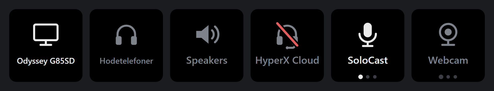

<div align="center">

# Audio Switch

**Change your Windows speakers, headphones or microphone with one Stream Deck key.**

[](https://github.com/EmilB04/StreamDeck/actions/workflows/ci.yml)




</div>

## Features

- **Two modes per key.** Switch to one device, or step through the ones you
  tick. Tick two and the key is a toggle.
- **Output and input.** Separate **Output Device** and **Input Device**
  actions, each listing only its own kind of device.
- **Calls and music apart.** A key can change the default device, the default
  communications device, or both. One key can move a call to your headset while
  music stays on the speakers.
- **A key that tells you the state.** It shows the device's name and an icon
  (speakers, headphones, headset, earbuds, soundbar, monitor, TV, microphone,
  webcam or line jack), lit while that device is in use.
- **Follows Windows.** Change the device in Windows' sound settings and the keys
  update within two seconds.
- **Nothing extra to install.** No helper program, no driver, no network access.

## Install

1. Download the `.streamDeckPlugin` file from the
   [latest release](https://github.com/EmilB04/StreamDeck/releases/latest).
2. Open it. Stream Deck installs the plugin.
3. Drag **Output Device** or **Input Device** from the **Audio Switch** category
   onto a key, and pick a device in the panel.

Requires Stream Deck 6.9 or later on Windows 10 or later. Stream Deck ships the
Node.js runtime the plugin uses, so you don't install Node yourself.

## Using it

Both actions have the same settings.

| Setting | What it does |
|---|---|
| **Mode** | Switch to one device, or step through several. |
| **Device** / **Devices** | What the key switches to. The list comes from Windows. A chosen device that isn't connected stays in the list, marked "not connected". |
| **Applies to** | Which of Windows' two defaults a press changes. |
| **Name** | Which of the device's names the key shows. |
| **Own text** | Your own text in place of the device's name. One-device mode only. |
| **Icon** | The picture on the key. Automatic guesses it from the device. |
| **Show icon** | Draws the picture above the name. |

### What the key shows

| Face | Meaning |
|---|---|
| White icon and name | The key's device is in use. |
| Grey icon and name | It is not. |
| Red slash through the icon | The device is not connected. A press shows the alert mark. |
| Row of dots | A step-through key: one dot per connected device, the white one is current. |

With **Everything**, "in use" means the device you hear. If calls are set to go
elsewhere the key is still lit, and a press brings calls along.

A step-through key always names the current default. If that isn't one of its
own devices, the name is grey and no dot is lit. The next press goes to the
first of its devices.

<details>
<summary><b>Applies to</b>: default device and communications device</summary>

<br>

Windows keeps two defaults for each direction. Most programs use the **default
device**. Call software such as Discord and Teams uses the **default
communications device**.

| Choice | Changes |
|---|---|
| Everything | Both. This is the default. |
| Apps, games and music | The default device only. |
| Calls only | The default communications device only. |

A program that is set to a specific device in its own settings ignores both
defaults, and no key changes that.

</details>

<details>
<summary><b>Name</b>: why Windows' device names need help</summary>

<br>

Windows gives every device two names: what it is ("Speakers") and what it is on
("Realtek Audio"). Neither is reliably the useful one. Three microphones can all
be called "Microphone", and two monitors can both be on "NVIDIA High Definition
Audio". **Automatic** uses the first name unless another device shares it, and
then uses the second.

</details>

<details>
<summary><b>Icon</b>: how the guess works</summary>

<br>

Automatic uses the device's name first, in a few languages ("Headphones",
"Hodetelefoner", "Kopfhörer"), then the form factor Windows records for the
endpoint (speakers, headphones, headset, HDMI display). A monitor's speakers
show a monitor, and a webcam's microphone shows a webcam. The guess never gives
a recording device a playback picture. Pick an icon in the panel when it guesses
wrong. A step-through key shows the icon of whichever device is current, unless
you pick one.

</details>

## How it switches

Windows has no documented API for changing the default audio device. The plugin
calls `IPolicyConfig::SetDefaultEndpoint`, the same COM method the Sound control
panel uses. The method is undocumented and has kept its shape since Windows 7.

Node can't call COM, so the calls are made in C#
([`src/audio/host-script.ts`](src/audio/host-script.ts)). The plugin starts one
hidden `powershell.exe`, which compiles the C# with `Add-Type` and then answers
requests on stdin for as long as the plugin runs. Starting it takes one to two
seconds, once. After that a request takes about 15 ms, so a press is immediate.

This means the plugin ships no executable and has no native dependency. It
builds on any OS, and there is no unsigned binary for antivirus software to
question. The script is passed inline with `-EncodedCommand`, so the PowerShell
execution policy, which governs script files, doesn't apply. The plugin makes no
network requests.

## Development

You need Node.js 20 or later to build from source.

```sh
npm install
npm run build           # rollup -> com.emilberglund.audioswitch.sdPlugin/bin/
npx @elgato/cli link    # link the .sdPlugin folder into Stream Deck
```

`npm run pack` builds and writes the installable
`dist/com.emilberglund.audioswitch.streamDeckPlugin`, the same file the releases
carry. The CLI also rewrites `manifest.json` in place to normalize it; expect
that diff.

<details>
<summary><b>Developing from WSL</b></summary>

<br>

If you edit the source in WSL while Stream Deck runs on Windows, install the
packed plugin once, then deploy to the Windows-side copy:

```sh
npm run deploy          # build, rsync to the installed plugin folder, restart the plugin
```

The script finds the folder Stream Deck loads (set `SD_PLUGIN_DIR` to override),
skips `logs/`, and restarts the plugin by ending its `node.exe`. Stream Deck
starts it again within a couple of seconds. `npm run watch` only works from
Windows.

</details>

### Tests

```sh
npm run typecheck && npm run lint && npm run format:check && npm test
```

The tests run on any OS and never start PowerShell. They cover the decisions
([`switching.ts`](src/actions/switching.ts)), settings, device-type guessing, the
reply parser, the host's request queue against a fake process, and the key
renderer. The C# itself is not unit-tested.

<details>
<summary><b>Check the C# against a real machine</b></summary>

<br>

After `npm test` has compiled to `.test-build/`, list the devices from a Windows
or WSL shell:

```sh
node -e '
const { spawn } = require("node:child_process");
const { encodedCommand } = require("./.test-build/src/audio/host-script.js");
const ps = spawn("powershell.exe", ["-NoProfile", "-NonInteractive", "-InputFormat", "None", "-EncodedCommand", encodedCommand()]);
let lines = 0;
ps.stdout.on("data", (d) => { console.log(String(d).trim()); if (++lines === 1) ps.stdin.write("list\n"); else ps.stdin.end(); });
'
```

It prints `{"ready":true}` and then one JSON line with every active device.

</details>

### Debugging

The plugin logs to `logs/` inside the installed `.sdPlugin` folder. Lines from
the PowerShell host start with `audio-host:`. A press that does nothing logs its
reason, for example `output: press ignored, the chosen device is not connected`.

If keys stay on the grey placeholder image, the host did not start. The log says
why: PowerShell missing or blocked, or a compile error.

### Project layout

| Path | Contents |
|---|---|
| `src/audio/host-script.ts` | The C# and the PowerShell around it, as a string. |
| `src/audio/host.ts` | Runs the PowerShell process. One request at a time, with timeouts and restart. |
| `src/audio/devices.ts` | Parses replies, holds the current device list, polls while a key is visible. |
| `src/audio/device-kind.ts` | Guesses what a device is, from its name and form factor. |
| `src/actions/switching.ts` | Every decision: what a press does, what a key shows. No I/O. |
| `src/actions/device-key.ts` | The action class both actions share. |
| `src/ui/key-svg.ts` | Draws the key face and the icons. |
| `com.emilberglund.audioswitch.sdPlugin/ui/` | The property inspectors. |
| `scripts/gen-icons.py` | Draws the static icons (needs Pillow). |
| `docs/keys.png` | The image at the top, rendered from `key-svg.ts`. |

## Third-party code

`com.emilberglund.audioswitch.sdPlugin/ui/sdpi-components.js` is
[sdpi-components](https://sdpi-components.dev) v3.0.2, carried as a local copy
and not loaded from a CDN. A property inspector can write action settings, so it
should not run code fetched at runtime. The local copy also lets the panels work
offline.

## Licence

MIT with an attribution clause; see [`LICENSE`](LICENSE). Use it, change it, ship
it, sell it. Keep the copyright notice, credit Emil Berglund as the original
creator, and link back to this repository somewhere a reader can find it. No
warranty.
