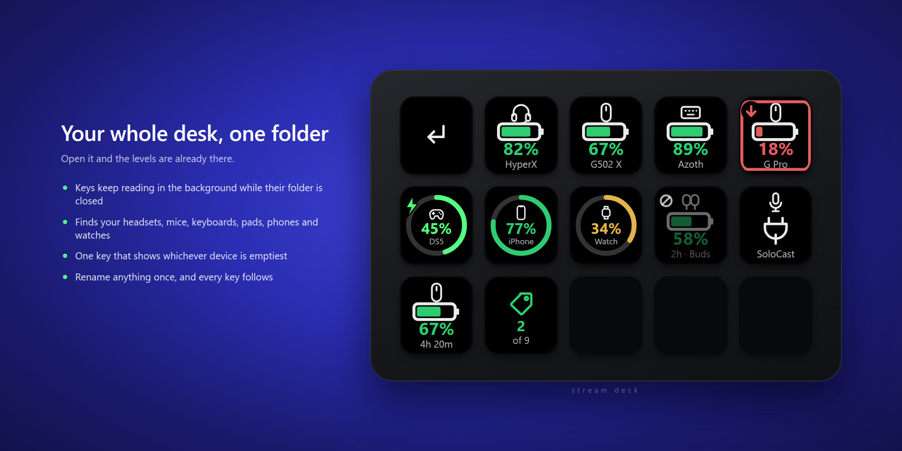
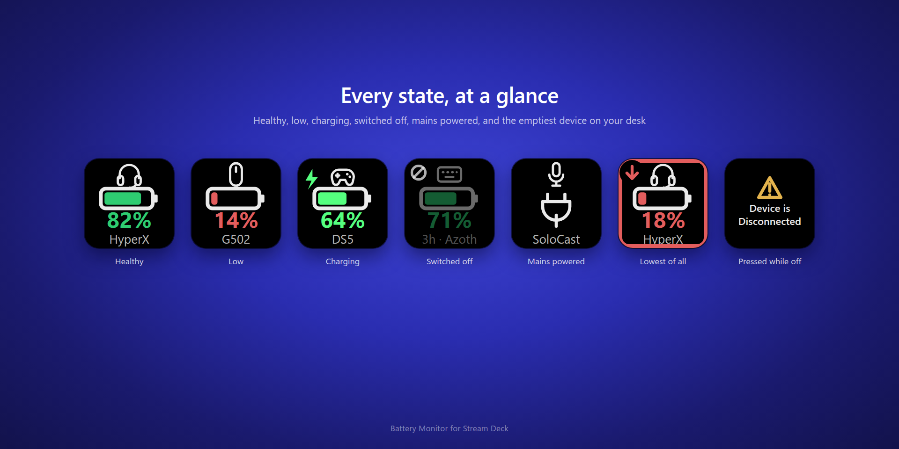
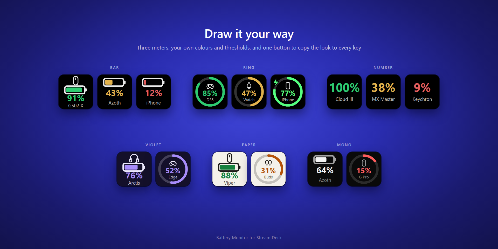
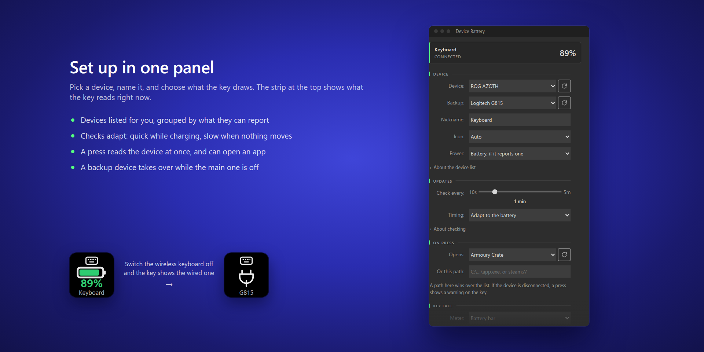
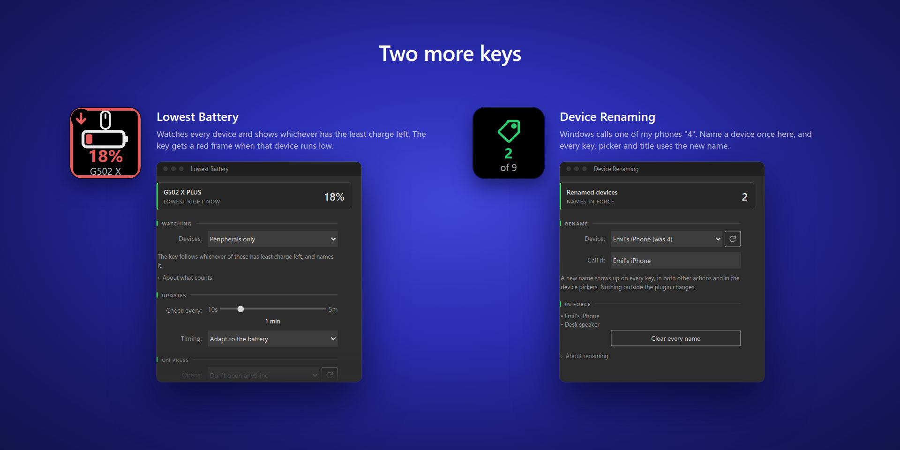

# Battery Monitor (Stream Deck plugin)

A Stream Deck plugin that shows the battery level of your wireless devices on a
key. **Device Battery** scans the computer for wireless peripherals, lets you
pick one in the property inspector, and draws its level on the key. It polls on
an interval and reads again when you press it. Two more actions sit beside it:
**Lowest Battery** and **Device Renaming**. To add another, put a file under
`src/actions/` and a matching entry in `manifest.json`.

The plugin has no model list. It fills the device picker at runtime from what
the machine reports, so new gear shows up when you plug it in.

## What it looks like



A folder of keys, each with its own meter, percentage, icon and name line. They
keep reading while the folder is closed, so it opens with current levels. The
`2h` prefix on the earbuds shows how long ago the plugin last heard from them.



Every state a key can be in: healthy, under the low threshold, charging (a bolt,
and the face breathes), switched off (dimmed, last known level), mains powered,
the **Lowest Battery** frame once its device runs low, and the message a press
leaves when the device is gone.



Three meters, with your own colours and thresholds.



The property inspector. The strip along the top shows what the key reads while
you configure it, so you spot a wrong device before you close the panel.



The other two actions.

## How devices are detected

Each provider lists what it can see. `src/providers/discovery.ts` merges the
results, sorts them and caches them for 10s.

| Provider | Finds | Battery source |
|---|---|---|
| `headsetcontrol.ts` | Every headset [HeadsetControl](https://github.com/Sapd/HeadsetControl) supports (~100 models across HyperX, SteelSeries, Corsair, Logitech, Razer…) | Shells out to the CLI, which has reverse-engineered each headset's HID report. Names come from its output. |
| `logitech.ts` | Every device paired to every Logitech receiver, plus directly connected ones | HID++ 2.0 over `node-hid`. The device reports its own product name and form factor (feature `0x0005`). Battery comes from `0x1004` Unified Battery, with legacy `0x1000` as the fallback. |
| `asus.ts` | Any ASUSTek HID device that presents as a peripheral, named from its USB product descriptor | The ROG receiver's vendor collection. ASUS publishes no spec; I worked the protocol out on real hardware and checked it against Armoury Crate (see "Asus battery protocol"). |
| `razer.ts` | Razer wireless mice, keyboards and headsets | The OpenRazer control protocol: a 90-byte feature report carrying the power command class. No model list; anything that answers reports its level. **Unverified against hardware.** |
| `xbox.ts` | Xbox Wireless Controllers over Bluetooth | Input report `0x04`, one byte of flags: four capacity steps rather than a percentage. Dongle and USB use GIP rather than HID, so the plugin can't read them. **Unverified against hardware.** |
| `dualsense.ts` | PlayStation controllers: DualSense, DualSense Edge, DualShock 4, over USB or Bluetooth | The pad's own input report (see "DualSense battery"). Neither OS route sees it: the pad pairs as Bluetooth Classic, so Windows has no GATT battery service to mirror, and over USB it's a plain HID gamepad. |
| `windows-bluetooth.ts` | Every paired, present Bluetooth device | The `DEVPKEY_Bluetooth_Battery` PnP property (the number the Settings app shows), read through PowerShell. It works for any vendor, but Windows sets it on Bluetooth **LE** devices with a GATT battery service and nothing else. Classic devices still appear, without a level. |
| `generic-hid.ts` | Every HID device on the machine, including the vendors above | Nothing: it has no battery protocol. Cable-connected devices count as mains powered. Wireless ones, and anything named like a receiver, count as unreadable, since they may have a battery the plugin can't see. |

The plugin stores each device as a stable key instead of a HID path. Logitech
devices use their HID++ unit id, headsets their USB vendor/product ids,
Bluetooth devices their PnP instance id, a DualSense its MAC address. You can
unplug and replug, and the key keeps working.

A scan takes ~3s. The 10s cache stops the property inspector and the key from
rescanning in lockstep. A key press forces a fresh read.

The picker lists every detected device, with the ones that report a level first.
One piece of hardware can reach two providers: a DualSense is both a Sony HID
device and a paired Bluetooth node, and a HyperX headset is both a
HeadsetControl device and a plain HID interface. `mergeGeneric` drops the entry
that can't read a battery when another one can. It matches on the name, loose
enough to survive the HID layer's manufacturer prefix ("HP, Inc HyperX Cloud
Alpha Wireless" vs "HyperX Cloud Alpha Wireless"), and falls back to equality
for names too short to match safely.

The catch-all lists the four vendors that have a provider of their own on
purpose, and `mergeGeneric` pairs those entries off by USB vendor/product id.
This covers a dedicated provider coming up empty: a vendor tool holding the
interface open, an unfamiliar usage page, a device asleep behind its dongle.
The catch-all used to skip those vendors, and in each of those cases the device
vanished from the picker. Now the picker offers it without a level, and you can
see it exists.

### When a device isn't listed

`bin/scan.js` ships inside the installed plugin for this. It prints every HID
interface the machine exposes, then what each provider made of them:

```pwsh
node "$env:APPDATA\Elgato\StreamDeck\Plugins\com.emilberglund.batterymonitor.sdPlugin\bin\scan.js"
```

Reading the output:

- **`node-hid did not load`**: every HID provider is off. Fix that first; the
  rest of the output means nothing until you do.
- **The device isn't in the HID list**: Windows doesn't expose it. A vendor tool
  with an exclusive handle (G HUB, Armoury Crate, Synapse) causes this, and so
  does a device that's off.
- **It's in the HID list but not in the device list**: a provider bug. Please
  open an [issue](https://github.com/EmilB04/StreamDeck/issues) and include the
  interface lines; the `usagePage` usually decides it.

The plugin log has a short version of the same thing, a
`discovery: headset=0 logitech=2 asus=1 …` line per scan, under
`%APPDATA%\Elgato\StreamDeck\Plugins\com.emilberglund.batterymonitor.sdPlugin\logs\`.

## Third-party code

`com.emilberglund.batterymonitor.sdPlugin/ui/sdpi-components.js` is
[sdpi-components](https://sdpi-components.dev) v3.0.2. The plugin carries its
own copy. Elgato's samples load it from a CDN with `<script src>`, and the first
version of this plugin did too. A property inspector holds the Stream Deck
websocket and can write action settings, and one of those settings names an
executable to launch. Anyone who compromised the CDN, or intercepted the
request, could have run code on every machine with the plugin installed. The
local copy also lets the panels work offline and keeps the store listing's "no
network requests" claim true.

To update it, download it again from the same URL, check the version banner at
the top of the file, and open all three panels to test them.

## Requirements

- Stream Deck app on Windows 10 or later. I haven't run the HID providers on
  macOS, so the manifest doesn't claim it.
- No separate Node.js install: Stream Deck 6.5+ ships the Node 20 runtime the
  plugin runs on. You need Node yourself only to build from source.
- [HeadsetControl](https://github.com/Sapd/HeadsetControl/releases) on `PATH`
  for headsets. The Windows release ships an installer with an "add to PATH"
  option, which the panels tell you to tick. No package manager carries the CLI
  (winget, Scoop and Chocolatey only have GUI wrappers), so the panels can't
  point you at one.

  `candidateBinaries()` also probes `%LOCALAPPDATA%\Programs\HeadsetControl\` and
  `%ProgramFiles%\HeadsetControl\`, the installer's defaults, so the plugin finds
  the tool even if you skipped the PATH option. `HEADSETCONTROL_PATH` overrides
  both.

  Both battery panels show a banner at the top while the tool is missing. Once
  the plugin finds it, the banner goes away and the "Headset support" section
  names the copy in use, so you can see the install worked. The download button
  calls `streamDeck.system.openUrl`, which opens your real browser; the
  inspector is a webview with nowhere to put a page. Everyone sees the banner,
  headset or not, because the plugin can't tell a headset that reports no level
  from one it can't see at all.

## Install

Download the `.streamDeckPlugin` file from the
[latest release](https://github.com/EmilB04/StreamDeck/releases/latest) and open
it. Stream Deck installs it.

## Build & install

```sh
npm install
npm run build           # rollup -> com.emilberglund.batterymonitor.sdPlugin/bin/
npm run sync-deps       # installs node-hid into the .sdPlugin folder
npx @elgato/cli link    # symlinks com.emilberglund.batterymonitor.sdPlugin into Stream Deck's plugin folder
```

`npm run pack` builds, syncs the dependencies, and writes the installable
`dist/com.emilberglund.batterymonitor.streamDeckPlugin`, the same file the
releases carry. Use it to hand a build to someone without a toolchain. The CLI
also rewrites `manifest.json` in place to normalize it; expect that diff.

Then drag "Device Battery" onto a key in the Stream Deck app and pick the
device and interval in the property inspector. The refresh button beside the
device list rescans without restarting the plugin.

### Developing from WSL

If you edit the source in WSL while Stream Deck runs on Windows, you need one
extra step. A WSL path can't back the symlink under `%APPDATA%`, and
`streamdeck restart` fails from a WSL shell: cmd.exe refuses a UNC working
directory, and the CLI then reports "Stream Deck is not running" and does
nothing. So deploy to the Windows-side copy of
`com.emilberglund.batterymonitor.sdPlugin` instead:

```sh
npm run deploy          # build, rsync to the installed plugin folder, restart the plugin
```

The script follows the link Stream Deck loads to find the target (set
`SD_PLUGIN_DIR` to override), skips `logs/`, and restarts by killing the
plugin's `node.exe`. Stream Deck respawns it within a couple of seconds.
`npm run watch` only works from Windows, for the same CLI reason.

`npm run sync-deps` works from either side. node-hid's npm tarball carries a
prebuilt binary for every platform, Windows included, and the install step
_verifies_ the host's binary and nothing more. If a package ever fails to load
on Windows, check that
`com.emilberglund.batterymonitor.sdPlugin/node_modules/node-hid/prebuilds/HID-win32-x64/`
survived. That's the binary that ships.

## Tests

```sh
npm test          # tsc -p tsconfig.test.json && node scripts/run-tests.mjs
```

No test framework and no extra dependencies: `node:test` plus the TypeScript
already here. Tests compile to CommonJS in `.test-build/` because the plugin's
imports have no file extensions. The bundler and `require` resolve those; ESM
under Node would not.

`scripts/run-tests.mjs` expands the file list before it calls `node --test`.
Node changed the meaning of those arguments: up to Node 20 they are paths and a
glob stays literal, and from Node 22 on they are globs and a bare directory runs
as a file. CI runs Node 20, the version Stream Deck's runtime declares, so a test
setup that leans on the newer behaviour passes on a modern Node and fails in CI.
The script also runs one file at a time. Importing the Stream Deck SDK opens and
rotates a log file under `logs/`, and two test processes doing that at once
failed about one run in ten.

The 137 cases cover the logic that's easy to get wrong without noticing: the
discharge estimator and its refusal to extrapolate from thin evidence, the
adaptive poll policy, the settings migrations, the provider dedupe, the
PlayStation status bytes, keys leaving and rejoining the screen, the shared
look, the backup device, and the key face. The key face tests assert against the
rendered SVG, since that string is what ships.

The cases use real inputs where they exist. The DualSense tests use `0x08` and
`0x28`, the bytes a pad on my desk sent. The dedupe tests use the "4" that
Windows reports for one of my phones, the name that forced the short-name guard.

Mutation check: breaking each of these makes the suite fail.

| Change | Result |
|---|---|
| DualSense charge-complete forced back to 100% | 1 failure |
| short-name guard in the dedupe removed | 1 failure |
| estimator's ten-minute evidence window dropped | 1 failure |
| stale readings no longer faded | 1 failure |

## Publishing to Marketplace

```sh
npx streamdeck validate com.emilberglund.batterymonitor.sdPlugin
npm run pack
```

`pack` validates first and writes a `.streamDeckPlugin`. Upload that in
[Maker Console](https://docs.elgato.com/maker-console/managing-products/) with an
app icon and gallery images. Review takes 4–10 business days.

Already prepared:

- **`.sdignore`** keeps development leftovers out of the package: logs, editor
  state, source maps, and node-hid's prebuilt binaries for platforms the
  manifest doesn't declare (about 4 MB of a 5 MB package). It keeps
  `bin/scan.js` on purpose; see "When a device isn't listed".
- **Action and category icons are monochrome white on transparent**, as the
  [icon guidelines](https://docs.elgato.com/guidelines/stream-deck/plugins/)
  require for anything in Stream Deck's own lists. The app icon and the store
  listing stand alone, so they keep their colour.
- **`store/app-icon-256.png` and `-512.png`** are the Marketplace listing icon,
  a separate asset from the manifest's. You upload it in Maker Console, so it
  lives outside the `.sdPlugin` folder and never ships.
- **`store/listing.md`** has the listing copy and the gallery checklist.
- **Version `1.2.1.0`**, and **Windows only**: the manifest declares no macOS
  support. Much of the code might work on a Mac: the PowerShell providers turn
  themselves off, `launch.ts` handles `open`, and node-hid ships darwin
  binaries. But HID reads there need Input Monitoring permission, and I haven't
  run any of it on a Mac. A reviewer who finds a dead platform rejects the
  plugin, so macOS waits until someone tests it.

Still open before submitting:

- **Razer, Xbox and DualShock 4 are unverified** against hardware, and public
  users will run that code. Their picker entries read
  "(untested, please report)", set from `DiscoveredDevice.unverified` in each
  provider. Remove the flag as hardware confirms each one.
- Optional: **DRM** needs `SDKVersion: 3` and `Software.MinimumVersion: 6.9`.
  It encrypts the package, and the manifest stays readable at runtime.

## Actions

**Device Battery**: one device on one key, chosen in the property inspector.

You can also give it a **Backup** device. The key shows the backup while the
main device is offline, meaning not detected, or detected but not answering.
Pair a wireless keyboard with a wired one and the key shows the wireless
battery while it's on and the wired keyboard while it's off. As soon as the
main device answers again, the key goes back to it.

The backup goes by its own name, since the key's Nickname names the main
device. Its readings never touch the main device's stored level, discharge
history or charging guess, and the key never shows the main device's stored
level under the backup's name.

**Device Renaming**: renames devices across the whole plugin. Names come from
the OS or the device's descriptor, and you often can't fix them at the source:
Windows reports one of my phones as **4**. A key's Nickname fixes that for one
key. A rename fixes it on every key, in both other actions and in every device
picker, because the name belongs to the device. The plugin changes nothing
outside itself: no OS record, no firmware. It applies the map wherever it shows
a label.

Global settings hold the names, keyed by the device's stable key, so they
survive reconnects, reboots and the device being off. Nickname beats rename, and
rename beats whatever the device calls itself.

**Lowest Battery**: whichever detected device has the least charge, named on the
key. Five keys can each show a healthy number while a sixth device runs flat;
this key shows you the sixth. It reads nothing itself. Discovery has already
collected every level, and the key picks from those.

A chevron in the top left marks the key as "the emptiest of several" rather than
one device's own reading. That corner holds all of this plugin's markers: the
charging bolt, the offline glyph and the chevron. The chevron gives way to the
bolt while charging, so the corner shows one marker at a time. The chevron takes
the meter's colour. Once the device drops to the low threshold, the whole key
gets a frame in that colour, since one low number among five healthy keys is
easy to miss.

The key compares live readings. A switched-off device can't win with
yesterday's level, and a mains-powered one has nothing to compare. **Peripherals
only** (the default) leaves out phones, tablets and watches, which have their
own chargers and warnings. On my machine that's the difference between a
keyboard at 81% and a phone at 56%.

## Customizing the key

These settings are per key, in the property inspector, grouped as Device →
Updates → On press → Key face → Levels → Colours. A strip at the top shows what
the key reads right now. The plugin answers from the reading it already drew, so
the panel can ask every few seconds without touching a device. Longer
explanations sit behind "About …" disclosures.

| Setting | Options | Default |
|---|---|---|
| Device | whatever discovery found; the refresh button beside it rescans | first battery-capable device |
| Backup | a second device, shown while the first is offline | none |
| Nickname | your own name for the device on this key | its own name |
| Icon | which form factor to draw, or auto | auto |
| Power | battery if it reports one, or "always plugged in" for the plug symbol | battery |
| Check every | 10–300 seconds | 60 |
| Timing | adapt to the battery, or keep that interval | adapt |
| Opens | nothing, an installed app, or a path or link you type | nothing |
| Meter | battery bar, ring around the key, or percentage only | battery bar |
| Show | device icon, percentage, name line, last level when off, time left, how long since it was seen | percentage, name line, last level, age |
| Deck title | nothing, the nickname, or the percentage | nothing |
| Low up to | 0–50% | 20 |
| Medium up to | 10–90% (above it, the high colour) | 50 |
| Warn below | 0 turns it off; above 0, Stream Deck's alert icon flashes once as the level crosses under it | 0 |
| Colours | low, medium, high, charging, outline, background | see below |

Default colours: low `#e35d5d`, medium `#e3b34d`, high `#2ecc71`, charging
`#55ff7f`, outline `#eaeaea`, background `#000000`.

While charging, the key shows a bolt in the top left and breathes in the
charging colour, a ~3.6s opacity swing between 0.78 and 1.0. Stream Deck
rasterises each image once, so SMIL or CSS animation inside the SVG does
nothing. The plugin re-sends a frame every 450ms instead. Each frame re-renders
the cached reading, so an animating key does no device I/O.

### Polling

Each check costs work: a HeadsetControl process, a PowerShell process for the
Bluetooth property, and HID handles on the Logitech, Asus and Sony devices. At
the 60s default that's fine. At 10s a scan runs about a quarter of the time, for
a number that moves in 10% steps on most devices.

**Timing: adapt** is the default. It sets the next check from the reading
(`adaptiveSeconds` in `src/actions/settings.ts`):

| State | Next check |
|---|---|
| Charging | 15s |
| At or below the low threshold | 30s |
| Steady reading | your interval × 1.5 per unchanged reading, up to 10 min |
| Device off or erroring | 2 min, or your interval if that's longer |

Your interval is the baseline. Charging and low levels can only *shorten* it, so
a key set to 15s stays at 15s, and any change in the percentage resets the
backoff. `MIN_REFRESH_SECONDS` (10s) is the floor, and a press reads straight
away.

Polling runs as a chain of one-shot timers rather than an interval, so each tick
picks the delay for the next one. In fixed mode every delay is the same, which
matches the old behaviour.

### Keys in folders and on other pages

Stream Deck tells the plugin a key has disappeared when you close its folder or
switch to another page, and that it has appeared when you come back. Keys used
to throw away their state on the way out, so every folder showed the
placeholder image for about 3 seconds while a fresh scan ran.

Now a key that leaves the screen keeps its state and keeps reading in the
background, at most once a minute for up to 30 minutes
(`BACKGROUND_MIN_SECONDS` and `BACKGROUND_WINDOW_MS` in
`src/actions/key-face.ts`). While hidden, it paints nothing and raises no
alerts. When it comes back, the plugin paints it from memory at once and reads
again only if a read is due. If the level crossed the warning threshold while
the key was hidden, the alert flashes when it returns.

The 30-minute window exists because Stream Deck reports a deleted key the same
way as one in a closed folder. Without the window, the plugin would poll deleted
keys until it restarted. A key hidden for longer still repaints from memory when
it returns, then reads at once.

A key you haven't seen since the plugin started has nothing in memory. It paints
from the most recent scan if that's under 5 minutes old, or else from the level
its settings last stored, drawn as last known. The real read replaces it a few
seconds later.

### Devices with no battery

A device that never runs on a battery has no percentage, and a dash would
suggest a fault. Those keys draw a plug in place of the meter and the number.
The icon and name line stay, so you can still tell what the key is for.

Two things lead to that state. The catch-all HID provider marks cable-connected
devices as mains powered, since a wired mic or a USB fan has no battery. The
plugin can't judge the rest: a Bluetooth speaker with no level looks the same as
a headset whose battery Windows can't read. Those stay under "no battery data"
until you set the key's **Power** to "always plugged in", which forces the plug.

The picker groups devices under **Battery**, **Mains powered** and **No battery
data** headings, in that order. The headings are `<optgroup>`s, visible but not
selectable. The same `powerTier` function builds the headings and sorts the
list, so a device can't sit under one heading and sort as another.

### Pressing the key

A press reads the device straight away and skips the discovery cache. Set
**Opens** to have the press also open something: pick from the installed-app
list, or type any path, document or link the shell can handle (`steam://`,
`https://`, a `.lnk`). A typed path wins over the list.

The app list comes from `Get-StartApps` (`src/actions/apps.ts`): everything the
Start menu can launch, Store apps included. That covers more than shortcuts on
disk. The plugin caches it for 5 minutes, the picker's refresh button clears the
cache, and a filter drops non-apps like uninstallers, readmes and "visit our
website" links.

The plugin stores apps as `app:<AppID>` and launches them with
`explorer.exe shell:AppsFolder\<AppID>`, the route the Start menu takes. The
prefix exists because an AppID can look like a path or a URL. Windows returns
`Microsoft.WindowsCalculator_8wekyb3d8bbwe!App`,
`{6D809377-…}\Android\…\studio.exe` and `steam://rungameid/1172470` in the same
list, and only the AppsFolder route resolves the first kind.

The launch runs before the scan, so the app opens without waiting on ~2.3s of
HID work. The plugin spawns it detached and unreferenced, so it outlives the
plugin and doesn't hold Node's event loop open. On Windows it goes through
`cmd /c start "" <target>`; without the empty first argument, `start` would take
a quoted path as the window title. A bad path goes to the log. The key's warning
means "your device is gone", and a second meaning would blur it.

If the device is disconnected, the press also flashes Stream Deck's warning icon
and puts **"Device is Disconnected"** on the key for 2.5s, then restores the
face. Otherwise a press on a missing device would look ignored: the face already
shows the last known level, and a fresh read doesn't change it. Stream Deck gives
plugins no toast or tooltip, so the key carries the message (`noticeKeyImage`).

The warning goes up **before** the forced scan. The key knew a moment ago that
the device was missing, and that's what the press asks about; a ~2.3s rescan
first made the press look ignored. While a message is up, `render` does nothing,
so the scan finishing behind it can't paint over the message. The key draws the
cached reading when the message clears. If the scan is what discovers the device
is gone, the warning goes up then.

### Time remaining

With **time left** on, the name line shows an estimate ("2h 20m") in place of
the device name. A 72px key has room for one of the two, and once you know which
key is which, the estimate tells you more.

The key keeps a short history of levels in its settings (`recordSample`,
`estimateRemaining`) and takes the rate from the oldest and newest samples. A
median of intervals would resist an odd reading better, but wireless gauges move
in 10% steps, and over a handful of samples the endpoints are the trend.

The key shows nothing until it has evidence: a drop of at least 3% over at least
ten minutes. A rising level throws the history away, because a discharge rate
can't span a charge. Synthetic histories check it: a 5%/h drain at 70% reports
14h, a device with 10% steps reports 16h, and thin evidence reports nothing.

### One look across every key

**Apply this look to all keys** copies colours, thresholds and face options onto
every other Battery Monitor key, of either action. The plugin writes the look to
global settings under a new revision number, and `plugin.ts` pushes it into each
visible key. Both action types go through that one path, so neither button
needs to know about the other action. Keys in a closed folder take the look when
they next appear. A new key starts from the shared look instead of the shipped
defaults.

Each key remembers the revision it adopted (`appearanceRev`) and only takes a
newer one. Stream Deck answers every read of global settings with the same event
a panel edit produces, and the plugin reads them at startup, when you add a key
and on every rename. Before revisions, each of those reads pushed the shared look
onto every key again and undid any change you'd made to one key since.

After a share, the values are ordinary per-key settings. The button copies a
look once; it doesn't bind keys together, so you can still make one key
different.

### Offline devices

A wireless device that you switch off or carry out of range drops out of
detection. A key showing "—" would lose the one useful fact left: the level when
the device went away. So each key stores the last percentage its device
reported, in the action's settings, where it survives a plugin restart or a
reboot. The key shows it while the device is gone:

- The whole face draws at 45% opacity, so you can't mistake it for a live
  reading. The meter keeps its threshold colour, so you can still read the level
  at a glance.
- A crossed-out circle in the top left marks the reading as old. It sits on a
  disc of the background colour, like the lowest-battery chevron, so it stays
  readable over the meter.
- The name line, if on, starts with the age of the reading (`3h · Kraken V3`).
  The age goes first because the line truncates from the right. Turn off **how
  long since it was seen** if the prefix crowds out the name; the ring face, with
  the narrowest line, suffers most.
- The "percentage" deck title gets a `~` prefix (`~78%`).

The key writes the stored level when the percentage changes, or when its
timestamp is more than 5 minutes old, so an idle key doesn't write settings on
every poll. Any status without a live number gets the substitution, except
"mains powered", which has no level to miss. That includes "unsupported": a ROG
receiver whose keyboard is off reports exactly that, because the dongle is still
plugged in. A key that has read a percentage from the device before knows the
battery exists. Without this rule those keys showed "N/A" and dropped the last
level they knew.

The warning fires **once per trip** below the threshold. It used to flash on
every poll: at a 10s interval, six flashes a minute for as long as the device
stayed low. That's enough to make you turn the warning off and miss the alert
that mattered. The latch clears when the level recovers or the device starts
charging.

"Warn below" ignores a last-known level, or a device left off below the
threshold would flash forever. A device with no readable battery still shows
`N/A`, since it has no earlier level to fall back to.

Settings version 6 made adaptive polling the default. Keys on "fixed" had it
because it was the old default, so the migration moves them to adaptive. If you
choose fixed again afterwards, it sticks, because the key's version has moved
past the migration.

Two colour defaults have changed since v1: the charging colour (blue to green in
v2, then a brighter green in v4) and the background (near-black `#1e2024` to
`#000000` in v5). Existing keys follow when their colour is still one this
plugin chose (`LEGACY_CHARGING_COLORS`, `LEGACY_BACKGROUND_COLORS`). The
migration leaves a colour you picked alone.

### Charging without a charging flag

Some sources can't say whether a device is charging. The Windows PnP battery
property is a bare percentage, so a phone on a charger looks like one in a
pocket. Windows keeps a Boolean next to it (`{104EA319-…} 3`) that looks like a
charging flag, but it stays `False` on a phone whose level is climbing.

A provider declares this with `reportsCharging = false`, and the plugin infers
charging for its devices: **a level that went up since the last reading came
from a charger.** The bolt stays while the level holds (a phone parked at 100%
is still plugged in). It clears when the level drops, and when the device
disappears: a device that comes back higher was charged somewhere else and
isn't charging now.

The guess fails in one case. Unplug at a level the device then holds, and the
bolt stays until the first drop or for 20 minutes below 100%, whichever comes
first.

### Device icons

The plugin draws eleven form factors: headset, earbuds, mouse, keyboard,
gamepad, phone, tablet, speaker, microphone, watch, and a generic fallback.
Providers pick one from what they know (Logitech's HID++ device type, a HID
usage page, or the device's own name) and the key draws it.

Every glyph lives on one 24×24 grid at one stroke weight, then scales into its
slot: 21px in the flat styles, 17px inside the ring. The shared grid makes a
keyboard and a phone look like one set and keeps their optical sizes in step.
Before it, each glyph had hand-placed coordinates and its own weight. Strokes
are round-capped outlines. Details that would clog at 20px get filled: keycaps,
gamepad buttons, a speaker's tweeter.

### Layout

In the **bar** and **percentage** styles, the enabled elements stack and centre
as a group. In the **ring** style the ring runs around the edge of the key and
everything else sits inside it. At 72px, an icon, a ring, a percentage and a
name stacked on top of each other leave no room for a legible number; inside a
border ring they all fit.

SVG offers no text metrics, so the renderer sizes text from an estimated glyph
width. It sizes against the worst case, `100%`, so the layout doesn't jump when
a reading crosses 100 or drops to a dash. If the full stack still overflows the
key, the gaps close first, then the whole stack scales down.

Edits apply live. The plugin redraws appearance changes from the last reading
with no device I/O, so dragging a colour or a threshold repaints the key as you
go. Switching device costs a lookup, and that reuses the scan the property
inspector just ran.

### Titles

The actions set `UserTitleEnabled: false`, so Stream Deck hides its Title field,
and **Nickname** is the one place you name a key. **Deck title** can still ask
Stream Deck to draw a title over the image, in Stream Deck's font: the nickname
(or the device's own name when the nickname is empty), or the percentage.

Switching Deck title back to "Nothing" calls `setTitle()` with no argument,
which hands the title back to Stream Deck. Without that call, the last title the
plugin wrote would stay on the key. The plugin remembers the title it applied so
a repaint doesn't re-send it. That memory starts empty, so the first paint after
a restart clears a title left by a previous run.

Appearance defaults go into the key's settings the first time it appears, so the
property inspector's controls match what the key draws.

### Checking from a terminal

To see what the machine exposes without Stream Deck:

```sh
npm run scan
```

```
discovery: found 5 device(s) in 2942ms

HyperX Cloud Alpha Wireless
  key      headset:0x03f0:0x098d
  provider headset   kind headset
  battery  97% (ok)

G502 X PLUS
  key      logitech:d922d39a
  provider logitech   kind mouse
  battery  88% (ok)
```

While iterating:

```sh
npm run watch           # rebuilds on save and restarts the plugin in Stream Deck
```

Useful CLI commands (`npx @elgato/cli <cmd>`):
- `restart com.emilberglund.batterymonitor`: restart after a manual build
- `validate com.emilberglund.batterymonitor.sdPlugin`: check the manifest
- `pack com.emilberglund.batterymonitor.sdPlugin`: produce a distributable `.streamDeckPlugin`

## Debugging

Logger output lands in `com.emilberglund.batterymonitor.sdPlugin/logs/`. Every
scan logs how many devices it found and how long it took. Provider failures log
the provider id.

The manifest ships with `Nodejs.Debug` set to `"disabled"`. When it's
`"enabled"`, Stream Deck starts the plugin with Node's inspector listening on a
local port, and any program on the machine could attach and run code inside the
plugin. To step through the code, set it to `"enabled"` in your local copy and
don't commit it. The log files are written either way.

If a key shows `—`, `N/A` or `ERR`, run `npm run scan` to see which provider
fails and why. Each device prints its status and detail text.

If a key keeps showing the empty placeholder battery, the plugin's `setImage`
never landed. Two known causes: the image must be a data URI
(`data:image/svg+xml;charset=utf8,…`), since Stream Deck ignores a bare `<svg>`
string; and Stream Deck refuses plugin images on a key where you set a custom
image.

`npx @elgato/cli restart` fails here at times: it reports "Stream Deck is not
running" and does nothing. Killing the plugin process works, and Stream Deck
respawns it within ~2s:

```powershell
Get-CimInstance Win32_Process -Filter "Name='node.exe'" |
  Where-Object { $_.CommandLine -like '*batterymonitor*' } |
  ForEach-Object { Stop-Process -Id $_.ProcessId -Force }
```

### Debugging Logitech

1. Check the receiver enumerates: `node scripts/hid-scan.mjs 046d`. Receivers
   expose HID++ on a vendor usage page (`0xff00` on Unifying and Lightspeed)
   with two collections: usage `0x1` for short reports and usage `0x2` for long
   ones. Windows gives each collection its own handle and rejects report ids the
   handle doesn't declare, so the provider opens both and writes each request to
   the matching one. It skips an endpoint without a usage `0x2` collection.
2. Run `npm run scan`. A device that answers the HID++ ping but reports no
   battery shows up as "no battery data".
3. Device index, feature indices and response byte offsets can vary by firmware
   and receiver. Adjust them in `src/providers/logitech.ts`: `readBattery()` for
   the offsets, `DEVICE_INDICES` for which pairing slots to probe,
   `RESPONSE_TIMEOUT_MS` if the provider misses a slow device.

### Asus battery protocol

I implemented this against a ROG Azoth on the ROG OMNI RECEIVER (`0b05:1ace`)
and checked it against Armoury Crate. ASUS publishes no spec; I worked it out on
the hardware with `scripts/asus-*`. Three findings made it work:

1. **The command channel is the receiver's vendor collections.** `HIDP_CAPS`
   shows the `MI_02` collections (`0xff00`/`0xff01`/`0xff02`) with 64-byte input
   *and* output reports and no feature reports, which explains why every
   `getFeatureReport` attempt returned nothing.
2. **Each collection accepts one output report id**: `0xff02` -> `0x01`,
   `0xff00` -> `0x02`, `0xff01` -> `0x03`. Any other id fails with
   `ERROR_INVALID_PARAMETER`, including the conventional `0x00`.
3. **The reply arrives on the handle that sent the command**, and other handles
   on the same path never see it.

The command is `0x12` (read info), sub-command `0x01`:

```
send: <report id> 12 01 00 ...                 (64 bytes)
recv: 02 12 01 00 00 00 56 04 00 00 14 56 47 10 ...
                        ^^          ^^ ^^
                     [6] = 0x56 = 86%   |
                              [10] = 0x14 = 20% low-battery threshold
                                 [11] = 0x56 = 86% (mirror)
```

`[6]` is the battery percentage, with no scaling. `[10]` matched Armoury Crate's
"warn at 20%" setting, which confirmed the frame is the Power tab's data block.
`[11]` mirrors the level; the provider cross-checks the two and logs if they
ever disagree.

Unsupported commands answer `<report id> ff aa`, which the provider treats as
"no battery data".

The `0x12 0x07` battery command documented for ROG *mice*
([g-helper #745](https://github.com/seerge/g-helper/discussions/745)) returns an
unrelated value here (17 while the battery read 86), so the mouse layout doesn't
apply to this receiver.

**Charging state isn't implemented yet.** The frame probably carries it (`[7]`
was `0x04` at capture time), but I haven't captured a frame with the keyboard
plugged in, so the provider reports `ok`. To finish it, run
`node scripts/asus-cmd.mjs 12 01` on battery and again while charging, and diff
the frames.

### Asus tooling

| Script | Purpose |
|---|---|
| `scripts/asus-caps.ps1` | Dumps `HIDP_CAPS` per interface: the report lengths Windows expects. Read-only. |
| `scripts/asus-write.ps1 -IdSweep` | Finds which output report ids a collection accepts. |
| `scripts/asus-cmd.mjs` | Sends commands and prints replies; `--sweep12` walks the `0x12` read family. |
| `scripts/asus-probe.mjs` | Feature/output sweeps, `--listen` for passive capture, `--paths` to feed the PowerShell tools. |

If another ROG device doesn't answer, run `node scripts/asus-cmd.mjs --sweep12`
to find its sub-command. It prints every reply other than `ff aa` and flags any
byte that matches the level Armoury Crate shows.

### Brand coverage

Windows has no `Class=Battery` node for these peripherals and no battery
property outside Bluetooth LE, so each family needs its own protocol. Per brand:

| Brand | Headsets | Mice / keyboards | Controllers |
|---|---|---|---|
| Logitech | HeadsetControl | `logitech.ts` (HID++) | `logitech.ts` |
| Razer | HeadsetControl, or `razer.ts` | `razer.ts` | none |
| SteelSeries, Corsair, HyperX, Turtle Beach, Roccat, Astro | HeadsetControl | none | none |
| Asus ROG | HeadsetControl | `asus.ts` | none |
| Sony | none | none | `dualsense.ts` |
| Xbox | none | none | `xbox.ts` (Bluetooth only) |
| Anything on Bluetooth LE | `windows-bluetooth.ts` | `windows-bluetooth.ts` | `windows-bluetooth.ts` |

HeadsetControl fills most of the headset column: it has reverse-engineered ~100
models across those brands, and this plugin lists whatever it reports.
Installing it adds more coverage than anything else, so check for it first when
a headset shows no level.

The gaps are mice and keyboards from SteelSeries, Corsair, Roccat and others.
Each speaks its own vendor HID protocol, and unlike Razer, none has one
documented command that spans its range; the report differs per model. Adding
one means probing that device (`scripts/hid-scan.mjs` and the `asus-*` tools
exist for this), so someone holding the hardware should add it.

**Xbox controllers** work over Bluetooth only (`xbox.ts`) and report four steps
(see below). On the Xbox Wireless dongle or a USB cable the pad speaks GIP, and
no HID report carries its battery. That route needs the WinRT
`IGameControllerBatteryInfo` API, which the plugin's Node process can't reach.

**Nintendo** pads carry the level in a nibble of their full input report, but
getting that report takes a subcommand handshake. That's a bigger job than a
single feature read.

### Xbox battery

An Xbox pad sends its battery as input report `0x04`, one byte of flags, in the
layout Linux's xpadneo driver decodes:

```
bit 7    online
bit 4    charging
bits 3-2 supply kind (internal, AA cells, rechargeable pack)
bits 1-0 capacity: 0 critical, 1 low, 2 medium, 3 full
```

The byte has no percentage. The pad knows four steps, so the key shows 10, 35,
70 or 100% with the word ("Medium") in the detail line, and the number holds
until the step changes. That's the device's resolution.

The pad sends the report when the level changes, so a quiet pad may stay silent
while discovery listens. The provider asks for it as a feature report first,
then listens for a moment, and reports "didn't send a battery report" if nothing
arrives. `scripts/xbox-probe.mjs` listens for longer and prints every report id
it sees; run it if a pad stays blank.

Detection goes by shape: a Microsoft gamepad on a Bluetooth path. The provider
lists no product ids, so an Xbox One S pad, a Series X|S pad and the next model
all take the same route.

### DualSense battery

A DualSense reports its battery in the input report it already streams. One
byte holds both halves: the low nibble is the level in units of 10%, the high
nibble the charge state. Linux's `hid-playstation` uses the same layout:

```
31 41 7e 85 7d 80 00 00 01 08 ... 08 ...
|  |  |                           |
|  |  +-- sticks (LX LY RX RY)    +-- [54] status: level 8, state 0 -> 85%, discharging
|  +----- sequence / flags
+-------- report id
```

`percent = min(level * 10 + 5, 100)`; the `+5` puts each of the 11 steps at its
middle instead of its floor. State `1` is charging and `2` is charge complete.
Both mean the cable is in, so both show the charging indicator, as
`logitech.ts` does for its own charge-complete state. `a` and `b` are
temperature faults and `f` a charging error.

A DualSense reports "complete" well before its gauge reads full: a pad on the
charger at level 8 sends `0x28`, complete at 85%. Linux's driver rounds that up
to 100%. This plugin keeps the pad's own level, because a key that claims 100%
and then drops to 85% when you unplug misleads you. Level `0` with state `2` is
the one combination the plugin reads as full.

Bluetooth adds a catch. The pad connects in a compatibility mode whose report
is **also** id `0x01`. Windows pads it out to the full 78 bytes, so length can't
tell the two apart, and everything past the sticks and buttons is zero:

```
01 7e 85 7d 80 08 00 08 00 00 00 00 ...   <- no battery anywhere in here
```

Reading feature report `0x05` (calibration data) switches the pad to the full
`0x31` report for good. That's a GET_FEATURE, a read, so the provider still
never writes to the controller; games do the same when they take over the pad.
Over USB none of this applies: the report is id `0x01`, with the status one
byte earlier at `[53]`.

`node scripts/dualsense-probe.mjs` dumps the reports and decodes both candidate
offsets. I checked the layout above with it: 85%, matching the pad.

## Project layout

```
src/
  plugin.ts                  entry point, registers actions, spreads the shared look
  scan.ts                    `npm run scan`: prints discovery results to a terminal
  actions/
    key-face.ts              base class: poll chain, background reads, pulse, warning latch, titles, painting
    battery-status.ts        the "Device Battery" action (one device, plus an optional backup)
    lowest-battery.ts        the "Lowest Battery" action: picks the emptiest device
    device-renaming.ts       the "Device Renaming" action: plugin-wide device names
    appearance.ts            the shared look and its revision, cached from global settings
    renames.ts               the rename map, cached from global settings
    charging.ts              the charging guess for sources without a charging flag
    settings.ts              per-key settings shape, defaults and version migrations
    ui-messages.ts           the messages between the plugin and its panels
    apps.ts                  lists installed applications for the picker (Get-StartApps)
    launch.ts                opens the app, file or URL a press points at
  providers/
    discovery.ts             runs every provider, merges and caches the results
    types.ts                 BatteryProvider / DiscoveredDevice contracts
    coalesce.ts              shares one in-flight fetch between callers
    hid.ts                   lazy node-hid loader shared by the HID providers
    log.ts                   logging seam so providers don't depend on the SDK
    headsetcontrol.ts        headsets, via the HeadsetControl CLI
    logitech.ts              HID++ 2.0 (name, type, unit id, battery)
    asus.ts                  ROG peripherals, via the receiver's power command
    dualsense.ts             PlayStation pads (DualSense, DualShock 4), from their own input report
    razer.ts                 Razer peripherals, via the OpenRazer control protocol
    xbox.ts                  Xbox pads over Bluetooth, from input report 0x04
    generic-hid.ts           catch-all: lists every HID device, mains vs unreadable
    windows-bluetooth.ts     Windows PnP Bluetooth battery property
  ui/battery-svg.ts          renders the key face as an SVG data URI (no canvas or image library)
com.emilberglund.batterymonitor.sdPlugin/
  manifest.json
  ui/battery-status.html     Device Battery panel (the device lists are plugin datasources)
  ui/lowest-battery.html     Lowest Battery panel
  ui/device-renaming.html    Device Renaming panel
  ui/inspector.css           styling shared by all three panels
  bin/                       build output (gitignored)
test/                        node:test suites, one per module
scripts/
  run-tests.mjs              runs the compiled tests, one file at a time
  sync-runtime-deps.mjs      installs node-hid into the .sdPlugin folder
  deploy.mjs                 `npm run deploy`: WSL -> installed plugin folder, then restarts it
  hid-scan.mjs               lists connected HID devices, for reverse-engineering new providers
  dualsense-probe.mjs        dumps DualSense input reports and decodes the battery byte
  razer-probe.mjs            walks Razer interfaces and transaction ids, printing what answers
  xbox-probe.mjs             listens for an Xbox pad's battery report and decodes its flags
  gen-icons.py               draws the plugin and action icons at Elgato's asset sizes
store/
  listing.md                 Marketplace copy and asset checklist
  gallery/                   Marketplace gallery images, 1920 × 960
  portfolio/                 the same scenes at 3840 × 1920
```

## Adding a device family

Implement `BatteryProvider` (`discover()` and `read()`) in `src/providers/`,
then add it to the `providers` array in `src/providers/discovery.ts`. The
property inspector, key rendering and settings all work from whatever
`discover()` returns, so nothing else needs to change.

## Licence

MIT with an attribution clause; see [`LICENSE`](LICENSE). Use it, change it,
ship it, sell it. Keep the copyright notice, credit Emil Berglund as the original
creator, and link back to this repository somewhere a reader can find it. No
warranty.

The added clause makes this a non-standard licence. GitHub won't detect it as
MIT, and automated licence scanners will flag it as custom. I accept that in
exchange for an explicit credit requirement.

Third-party pieces keep their own terms. `node-hid` ships with the plugin and is
MIT-licensed. [HeadsetControl](https://github.com/Sapd/HeadsetControl) is
GPL-3.0; the plugin neither bundles nor links it, and runs it as a separate
program if you've installed it.
